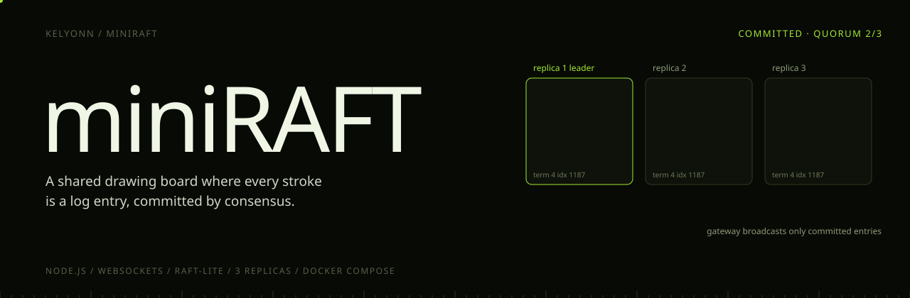
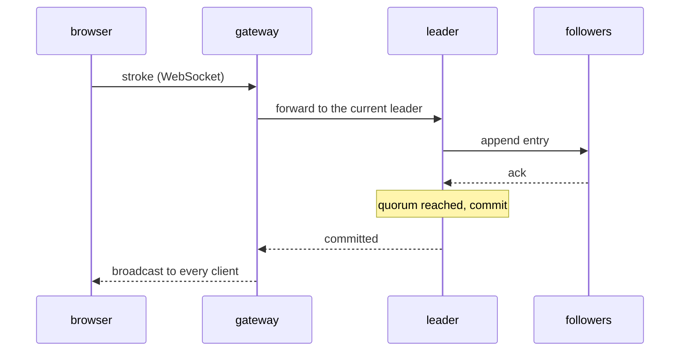

<p align="center">
  
</p>

<p align="center">
  <b>A shared drawing board where every stroke is a log entry, committed by consensus.</b><br>
  <sub>The canvas is deliberately simple. The interesting part is underneath: three replicas elect a leader, replicate every stroke, and commit it only on a quorum, so every client converges on the same picture through crashes and failovers.</sub>
</p>

<p align="center">
  <sub>
    <a href="#overview">OVERVIEW</a> &nbsp;·&nbsp;
    <a href="#quick-start">QUICK START</a> &nbsp;·&nbsp;
    <a href="#the-life-of-a-stroke">THE LIFE OF A STROKE</a> &nbsp;·&nbsp;
    <a href="#run-it">RUN IT</a> &nbsp;·&nbsp;
    <a href="#break-it">BREAK IT</a> &nbsp;·&nbsp;
    <a href="#tuning">TUNING</a>
  </sub>
</p>

<br>

<table>
  <tr>
    <td><sub>REPLICAS</sub><br><b>3</b></td>
    <td><sub>COMMIT RULE</sub><br><b>Quorum, 2 of 3</b></td>
    <td><sub>ELECTION TIMEOUT</sub><br><b>500–800 ms</b></td>
    <td><sub>HEARTBEAT</sub><br><b>150 ms</b></td>
    <td><sub>CLIENTS SEE</sub><br><b>Committed entries only</b></td>
  </tr>
</table>

## Overview

A shared drawing board where every stroke is a log entry, committed by consensus. The canvas is simple on purpose. The point is underneath: three replicas agree on each stroke before anyone sees it, so the drawing survives a server dying mid-line.

> [!TIP]
> Stop the current leader while you draw and watch the Cluster panel elect a new one. The board keeps working.

## Quick start

```bash
npm install
docker compose up --build
open http://localhost:3000     # draw in a few tabs
```


## The life of a stroke



The gateway never shows a client anything that has not been committed. If the leader dies mid-stroke, the gateway rediscovers the new leader and retries, so the board keeps working while the cluster heals.

A replica that restarts, or finds its log has diverged, catches up from the leader through `/sync-log`. State is persisted to a volume, so a restart is a recovery, not a reset.

## Run it

```bash
npm install
docker compose up --build       # 1 gateway, 3 replicas, 1 frontend
```

Open **http://localhost:3000** in a few tabs and draw. The **Cluster** panel shows the leader, the term and each replica's state as they change.

| Endpoint | Shows |
|---|---|
| `localhost:5001/status`, `5002`, `5003` | each replica's role, term and log |
| `localhost:8080/status` | the gateway's view of the cluster |

## Break it

Stop whichever replica the Cluster panel shows as leader, while drawing, and watch a new one get elected:

```bash
docker compose stop replica1      # if replica1 is the leader
docker compose logs -f gateway replica1 replica2 replica3
```

Every service writes structured JSON logs, so an election, a failover and a catch-up can all be read straight off the stream. A captured run is in `logs/failover.example.log`.

The integration suite does this on purpose, against an isolated local cluster: leader election, failover, a follower reset and catch-up, gateway broadcast, and convergence after a restart.

```bash
npm run test:integration
```

## Tuning

| Replica | Default | |
|---|---|---|
| `ELECTION_MIN_MS` | `500` | lower bound of the randomised election timeout |
| `ELECTION_MAX_MS` | `800` | upper bound |
| `HEARTBEAT_MS` | `150` | leader heartbeat interval |
| `NODE_ID`, `PEERS`, `PORT`, `DATA_DIR` | | identity, cluster membership, storage |

<details>
<summary><b>Layout</b></summary>
<br>

```
services/replica     follower, candidate and leader logic
services/gateway     WebSocket fan-out and leader forwarding
services/frontend    the canvas, served by Express
shared/              contracts and structured logging
docs/                architecture.md, testing.md
```

</details>

<sub>"Raft-lite": leader election, replication and quorum commit, without log compaction or membership changes. For a full Raft built from the paper, see <a href="https://github.com/kelyonn/cerberus">cerberus</a>.</sub>
